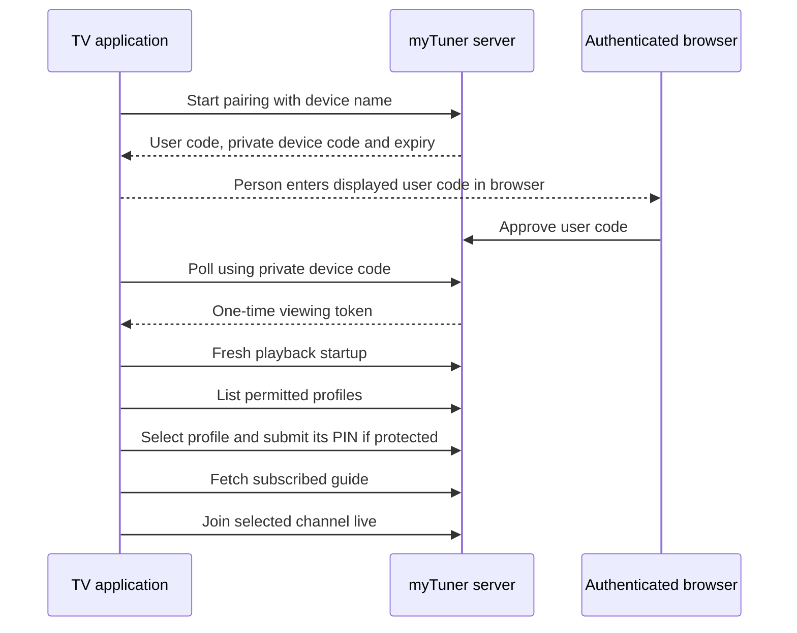

# Applications and user journeys

For the primary TV delivery path, read [TV installation and Unraid connection](TV_INSTALLATION.md). The supplied Figma references and current contract reconciliation are in [DESIGN_REVIEW.md](DESIGN_REVIEW.md).

For a step-by-step browser setup, follow [Create your first channel](FIRST_CHANNEL.md). This reference explains the responsibilities and longer-term flows.

## Which applications exist in the design

The intended experience uses our own server and clients. A browser is the desktop application surface for the first release; a separately installed Electron/Tauri desktop executable is not currently part of the plan.

| Application/system                                   | Responsibility                                                                              | Current state                                                     |
| ---------------------------------------------------- | ------------------------------------------------------------------------------------------- | ----------------------------------------------------------------- |
| myTuner server on Unraid or a library-connected host | Catalog, permissions, schedules, metadata, APIs and media delivery                          | Core non-UI implementation and CLI tooling present                |
| myTuner browser manager                              | Administration, library browsing, channel programming, subscriptions and generation control | Implemented React manager; local end-to-end/visual checks         |
| myTuner browser player                               | Profile guide, live join, pause/resume/Go Live                                              | Implemented direct/HLS browser player; real-file acceptance open  |
| myTuner Android/Google TV player                     | Pairing, profiles/PIN, remote guide and native playback                                     | Implemented Kotlin/Media3 POC APK; exact hardware acceptance open |
| myTuner Android-based Fire OS player                 | TV experience adapted/tested for exact Fire OS device                                       | Same Android APK; exact Fire OS hardware acceptance open          |
| Sonarr                                               | Optional TV metadata and file associations; continues its existing independent duties       | GET integration implemented; installed-service acceptance pending |
| Radarr                                               | Optional movie/collection metadata and file associations                                    | GET integration implemented; installed-service acceptance pending |
| Plex                                                 | May continue using the same files independently                                             | No dependency or connector in standalone implementation           |
| Unraid/Docker                                        | Run the server, mount sources and persist application volumes                               | Deployment scaffold; actual runtime acceptance pending            |
| Router/AP/firewall                                   | Permit client-to-server connectivity between selected networks                              | Separate infrastructure follow-up                                 |

These browser surfaces can share one web application and authentication session; they are not separate database owners. TV clients are installed on TVs/sticks and call the server. They do not install Sonarr/Radarr/Plex or run the database.

## Accounts versus profiles versus devices

An account is a login identity with a global role. An administrator creates accounts; there is no self-registration. A profile is a person or room, with an owner/members, source grants, optional PIN and channel subscriptions. One account may have several profiles and one room may have several permitted accounts.

A paired device has an expiring viewing credential tied to the approving account. It can select only permitted profiles and cannot gain management capability by pairing under an administrator. A PIN unlocks a permitted profile on that authentication session; it does not authenticate an unknown device or grant another user's sources/private channels.

Example: a household admin creates an editor account for Alex and a viewer account for Sam. Alex owns a personal profile and is allowed to manage a shared room profile. Sam is granted room membership. The room's subscriptions can include shared channels. Alex's private channel remains invisible to Sam, even if both use the room profile. Admin can inspect and subscribe to private channels without publishing them to Sam.

See [security](SECURITY.md) for exact authority rules and the administrator management/PIN distinction.

## Administrator onboarding

1. Provision the server's data/generated/cache directories and read-only media mounts.
2. Bootstrap the first admin locally using the CLI; start the service.
3. Sign in through the browser manager. Create accounts and person/room profiles, assign membership/management and configure optional numeric PINs.
4. Register show/movie/video/commercial sources, scan, and configure Sonarr/Radarr mappings where useful.
5. Grant profiles the appropriate source roots or subtrees. Inspect discovery results and unresolved mappings.
6. Create shared channels or owner-private channels, choose whole shows/seasons/folders/collections, configure ordering and optional commercials, preview and publish.
7. Subscribe profiles to eligible channels.
8. Pair viewing devices and validate real playback before treating the setup as ready.

The APIs support these operations now. The manager supplies account/profile/source setup forms and instructions for the initial CLI bootstrap. Household deployment acceptance remains open.

## Browser management journey

Sign in with an account password, choose an authorized profile/context and open the relevant management view. Admin can manage all setup; editor operations depend on ownership/profile grants; viewers receive viewing functionality.

Library selection should present artwork/list views, shows with season/episode drilldown, movies and collections, and custom folder trees. Selecting an entire dynamic show or folder avoids manual episode selection. Preview should make current availability, specials, ordering and commercial placement clear.

A channel builder saves repeating programming groups, not uploaded videos. Editing current programming becomes effective after the current program and its related breaks. Choose **Edit details** for name, optional short name and visibility; **Save channel details** takes effect immediately. **Edit programming** handles groups/commercials/preview/publication. Its **Edit details** button opens the details modal above the retained draft, then restores focus. Description and content-metadata editing remain pending I47 work. Archive remains a separate lifecycle action. Archive removes subscriptions and playback while retaining identity/configuration/history; restoration requires explicit resubscription.

## First TV setup

The TV needs an explicit server address in the first release. Automatic LAN discovery is optional future work; it must not be assumed across isolated networks. The displayed pairing code lasts five minutes; poll at the returned interval. Only the private device code can redeem the approval. Store the resulting token in protected platform storage.

## Every later TV launch

1. Use the saved valid pairing token; call `POST /api/playback/startup`.
2. Show available profiles with lock state. Do not restore a previous person's unlocked screen.
3. Select a profile; call its selection endpoint, which clears this authentication session's previous playback/unlocks.
4. Enter its numeric PIN if protected. Four digits are recommended for remote ease; the API allows four through eight digits. Explicitly unprotected profiles remain possible.
5. Load that profile's subscription-only channel guide and join the selected channel at its current live position.

Switching profiles repeats selection/PIN. Returning from a temporary overlay should not be confused with a fresh application launch; lifecycle handling belongs to the client. Pairing persists until expiry/revocation; it does not require typing an account password at each launch. Device tokens currently last 30 days. An expired/revoked token returns the implemented client to pairing.

The native client implements the profile picker, numeric keypad, focus navigation and startup/profile-switch lifecycle calls. Local emulator evidence and exact-device acceptance are recorded separately in [VERIFICATION.md](VERIFICATION.md).

## Watching and switching channels

Each channel has one live timeline. If two devices join at the same instant they resolve the same airing/source offset, subject to transport/player buffering. Joining midway through an episode or commercial is expected.

Pause freezes only this playback session. Resume continues behind live; Go Live resolves current active programming. Switching channels or reopening playback creates a new live join. Another viewer using the same profile continues independently.

The player must enforce interval boundaries for direct files, reload changing HLS state, stop unnecessary paused fetches and handle unavailable intervals/expired credentials. Tracks and subtitle timings need real-player integration. These obligations are detailed in [scheduling and playback](SCHEDULING_AND_PLAYBACK.md).

## Required UI states and handoff

Design must cover empty library, no subscriptions, missing artwork, incomplete scan, integration outage, inaccessible source, failed/expired pairing, wrong PIN/throttling, expired account/device session, forbidden/hidden resource, changed source, behind-live, unavailable airing, queue failure/cancellation and storage quota errors.

Browser needs keyboard/screen-reader access and responsive layouts. TV needs deterministic D-pad focus, clear Back behavior, readable couch-distance text and focus restoration. Visual regression should use fixed synthetic content and approved baselines. The complete design assignment remains [DESIGN_BRIEF.md](DESIGN_BRIEF.md); the server documentation does not prescribe final visual design.

## Network and TV cleanup follow-ups

A TV can remain on its current Wi-Fi/IoT network when routing/firewall rules permit it to reach the server's chosen address/port. The application cannot bypass network isolation. Broadcast discovery is not required for explicit-address operation. Verify address/DNS reachability and video throughput separately from software functionality; no router rules have been changed.

TV cleanup is optional model-specific maintenance. Removing unnecessary background work may improve responsiveness, but results require measurement and do not guarantee faster video decoding or repair network/codec limits. It is not an application prerequisite. Exact Bravia and Fire device models/OS versions must be recorded for acceptance.
