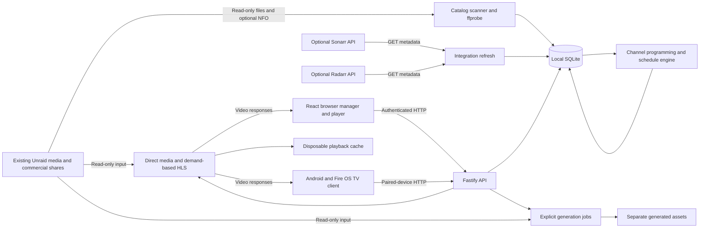

# Architecture and technology

## Product shape and current implementation

myTuner builds a personal TV network over files that already exist on Unraid. It owns the library catalog, permissions, channel programming, continuous timelines and playback APIs. A channel advances by wall-clock time even when nobody watches. Actual video conversion runs only on demand.

Version 0.2.0 implements one TypeScript server, its SQLite database, command-line operational tools, a React browser manager/player and a Kotlin/Media3 TV client. Docker includes the server and built browser; the native APK is installed separately. The owner approved the Figma designs before product UI implementation. See [applications](APPLICATIONS.md) for client scope and [verification](VERIFICATION.md) for acceptance limits.

## System diagram

Arrows from shares describe reads; myTuner does not write back into those shares. API and worker modules run in the same server process. The diagram separates responsibilities, not separately deployed microservices.

## Deployment and dependency boundaries

The server runs on the machine or Unraid host that can read the library. Clients need HTTP access to the server; they do not mount Unraid shares or access SQLite. A wired desktop can be a browser client without hosting the service. Docker packages the server, browser assets and FFmpeg; the native TV application runs on the television/stick.

Plex may continue using the same files independently. myTuner does not require Plex, a Plex token, Plex libraries or Plex streaming. A Plex-managed share is usable when myTuner has direct filesystem access to it. Access only through a remote Plex shared library is not enough: this implementation has no Plex import/streaming adapter.

Sonarr supplies show/episode metadata and file associations; Radarr supplies movie/collection metadata. Neither is asked to download, rename, move or transcode media. Both are optional: custom directories work with local metadata and filenames. Unraid owns shares and storage; the router owns connectivity between networks.

## Technology choices

| Technology                               | Current use                                                  | Reason and practical tradeoff                                                                                         |
| ---------------------------------------- | ------------------------------------------------------------ | --------------------------------------------------------------------------------------------------------------------- |
| Node.js 24.13+ within major 24           | Implemented server/runtime and CLI                           | Built-in SQLite, crypto, fetch and test runner; pinned major because SQLite API remains experimental                  |
| TypeScript with strict NodeNext modules  | Implemented backend                                          | Explicit contracts and ESM; type checks do not replace runtime validation                                             |
| Fastify 5                                | Implemented HTTP server                                      | Routing, request lifecycle and structured logs; authorization remains explicit in services/routes                     |
| Zod 4                                    | Implemented request/core response contracts                  | Runtime input validation and JSON Schema export; current schemas are not a complete OpenAPI document                  |
| SQLite through `node:sqlite`             | Implemented persistence                                      | One local database without a separate DB container; one active application owner and bounded synchronous transactions |
| FFmpeg and ffprobe                       | Implemented inspection, derivatives, HLS and text extraction | Broad format support; fixed CPU fallback has measurable compute cost and needs device acceptance                      |
| fast-xml-parser                          | Implemented optional NFO parsing                             | Local metadata without a matching service; bounded input and unsafe XML declaration rejection                         |
| Node crypto                              | Implemented scrypt, token digests and AES-GCM                | Password/PIN verification, opaque tokens and integration-key encryption                                               |
| React                                    | Implemented React/Vite browser application                   | Browser manager/player, local fonts, same-origin cookies and deferred Hls.js                                          |
| Kotlin and Android Media3                | Implemented native Android/Fire OS POC                       | Native TV focus and media support; exact device/OS compatibility remains to validate                                  |
| Docker/Compose                           | Windows-first packaging and acceptance tooling               | Consistent Node/FFmpeg runtime and explicit mounts; image/runtime acceptance remains open                             |
| node:test, tsx, Prettier, GitHub Actions | Implemented development tooling                              | Real SQLite/HTTP/media fixtures, TypeScript execution, formatting and CI definition                                   |

There is no Redis, external job broker, cloud database, search service, paid metadata service or subscription backend in this foundation. Subscriptions are channel choices inside profiles, not payments.

## Internal module map

| Area                    | Main files                                                         | Responsibility                                                                                  |
| ----------------------- | ------------------------------------------------------------------ | ----------------------------------------------------------------------------------------------- |
| Startup and composition | `main.ts`, `server.ts`                                             | Settings, path validation, process lock, service construction, routes, maintenance and shutdown |
| Domain and contracts    | `domain.ts`, `contracts.ts`, `public-json.ts`, `channel-label.ts`  | Internal models, request validation, core JSON Schemas and public response normalization        |
| Persistence             | `database.ts`                                                      | Append-only schema migrations, WAL, foreign keys and synchronous transactions/savepoints        |
| Identity                | `security.ts`, `identity.ts`, `identity-routes.ts`                 | Accounts, credentials, sessions, roles, memberships, PINs and pairing                           |
| Access lifecycle        | `access.ts`                                                        | Active stream checks and revocation cleanup                                                     |
| Catalog                 | `catalog.ts`, `local-metadata.ts`                                  | Contained reads, file identity/fingerprints, ffprobe and local metadata                         |
| Integrations            | `integrations.ts`, `refresh.ts`, `artwork.ts`                      | Read-only upstream import, encrypted settings, refresh and restricted artwork proxy             |
| Library                 | `library.ts`, `foundation-routes.ts`                               | Authorized discovery, dynamic selections and reference collections                              |
| Scheduling              | `scheduler.ts`, `programming.ts`                                   | Rotation algorithm, persisted decisions, revisions, preview and rolling extension               |
| Playback                | `playback.ts`, `streaming.ts`, `subtitles.ts`, `ranges.ts`         | Per-device clocks, direct ranges, HLS negotiation/conversion and text tracks                    |
| Generated outputs       | `generation.ts`, `storage.ts`                                      | Persisted jobs, presets, disk budgets, atomic assets and stale cleanup                          |
| Recovery                | `backup.ts`, `recovery.ts`, `runtime-lock.ts`                      | Consistent snapshots, offline staged restore, ownership and interrupted recovery                |
| Executables             | `bootstrap.ts`, `backup-cli.ts`, `verify-cli.ts`, `restore-cli.ts` | Admin creation, application backup, scratch verification and restore                            |

`display-metadata.ts` and `metadata-routes.ts` own source-separated display choices, cached integration/manual/local candidates, explicit read-only NFO checks, mirrored metadata roots and revision/fingerprint guards. Schema 14 adds `display_metadata`, channel description/details revision and source metadata-root fields. These presentation values do not change catalog identities, episode ordering, source bytes or schedules. See [metadata editing](METADATA_EDITING.md) for the complete contract.

All listed TypeScript paths are relative to `src/`. [CLIENTS.md](CLIENTS.md) maps the browser and native modules, build outputs, lifecycle, media requests and verification. See [development](DEVELOPMENT.md) for commands and test locations.

## Startup and shutdown

1. Resolve data/generated/cache locations and validate the port.
2. If a database already exists, inspect source roots read-only and reject storage overlap before creating outputs or applying migrations.
3. Acquire the data-directory ownership lock and reject a pending interrupted-restore journal.
4. Open SQLite, enable foreign keys/WAL/busy timeout and apply necessary migrations with a pre-migration snapshot for an existing older schema.
5. Revalidate paths, create writable output directories and load the private integration key. Missing key material for existing connections blocks startup.
6. Construct services, replay interrupted generation work, register routes and start maintenance/listening.

On SIGTERM/SIGINT the server aborts tracked streams during `preClose`, force-closes remaining HTTP connections without waiting for stalled viewers, stops/awaits workers, closes SQLite and releases its lock. It does not need a viewer to keep scheduling state persistent. Explicit encoders and queued generation tasks have separate lifecycles. Artwork preClose aborts/drains tracked fetches, response readers and pending cache work before close completes; cache publication rechecks shutdown state.

## Request and background work

Requests authenticate a browser/bearer/device session, check role/profile/channel/source scope, validate inputs, execute a service operation and return normalized JSON or authorized bytes. JSON responses use camelCase and object metadata. Streams remain subject to revocation after the original request check.

The running server checks maintenance every 30 seconds. It collects expired state, cleans the HLS cache, processes due refreshes and extends non-archived recurring channels. Guide/playback requests can also request schedule extension. Open original/derivative streams are rechecked every second and after mutations. Generation drains its durable queue independently; viewing does not trigger bulk generation.

## What persists and what is disposable

| State                                                                        | Where it lives               | Restart behavior                                                         |
| ---------------------------------------------------------------------------- | ---------------------------- | ------------------------------------------------------------------------ |
| Accounts, sources, catalog, selections, schedules, jobs and playback history | Local SQLite in data root    | Persisted                                                                |
| Integration encryption key                                                   | Private file beside database | Must survive restart and accompany application backups                   |
| Original media and commercials                                               | Existing read-only shares    | Managed outside myTuner                                                  |
| Explicit thumbnail/GIF/conversion outputs                                    | Generated root               | Reusable while fingerprint matches; not bundled in application snapshots |
| HLS/artwork/subtitle output                                                  | Cache subdirectories         | Disposable; rebuilt subject to limits/authorization                      |
| Active processes and shared conversion promises                              | Server memory                | Recreated on demand; partial outputs are not published                   |

## Scale and failure model

The POC deliberately uses one active server owner per data directory. Multiple HTTP clients share that process and database. Synchronous SQLite work and schedule computation must remain bounded; FFmpeg runs as child processes. This is not a horizontally replicated server or multi-writer database design. The process lock supplements that operating model; it is not a distributed lock across hosts or PID namespaces.

Failures preserve prior useful state where possible: an offline share does not mark the whole catalog missing, an upstream outage does not erase imported metadata, an impossible commercial break shortens during generation, and a changed source file cannot be served through an old fingerprint. Schedule catch-up commits bounded progress and may ask callers to retry rather than reset a channel.

Measure actual CPU, disk, network, encoding latency and concurrent viewers before changing concurrency or choosing hardware acceleration. Detailed budgets and recovery steps are in [operations](OPERATIONS.md). Accepted choices and unresolved decisions are in [decisions](DECISIONS.md).

## Client implementation in 0.2.0

The React/Vite manager and player live under `web/`, with locally bundled fonts and deferred Hls.js. The Fastify process serves the matching production `web-dist` build. Kotlin/Media3 under `android/` supplies the native TV/Fire OS player and protected device credentials. Both clients use the same authenticated APIs and existing read-only media; SQLite and all integration credentials remain on the server. Detailed module, lifecycle, playback and test responsibilities are in [CLIENTS.md](CLIENTS.md).

## Selected improvement service additions

The server adds `operations.ts` for bounded/cached admin status, setup progress, mapping samples and target-account effective-access reporting. `integration-report.ts` records complete-provider-read reconciliation candidates without applying metadata removal; its report retention and pagination are distinct from media ownership. SQLite migration 11 stores lineup order and import reports. These remain in the same server/database, not new deployable services.

Programming maintains stable group IDs and optional per-turn progress; one-time checkpoint commands execute at publication and are excluded from recurring config. Scheduler diagnostics are observational and do not consume additional randomness. Library catalog authorization now filters in SQL before grouping; bounded picker responses still require a linear authorized-catalog aggregation. Playback descriptors expose authorized session-time context without changing stream delivery/clocks. Generation forecasts reuse the same preset output paths as execution.

Native request identity and PIN/track helpers isolate state validation from Activity rendering. Browser draft/link helpers support the implemented selected UI extensions. [SELECTED_IMPROVEMENTS.md](SELECTED_IMPROVEMENTS.md) records the current UI checkpoint and historical foundation matrix; installed-provider, full visual/accessibility and hardware acceptance remain explicit.

## Sixth-round inspection and shared process admission

`collection-dependencies.ts` computes authorized collection impacts before paging/counts. `readiness.ts` analyzes stored catalog or active materialized channel entries without starting media work. Both the report and `streaming.ts` use the pure `playback-policy.ts` decision, including shortened-commercial HLS and unsupported text-caption limits. The video-details endpoint returns stored fields with profile/source authorization and no filesystem access.

One `EncoderAdmission` instance per server is injected into `GenerationRunner`, `StreamingService` and `SubtitleService`. `encoder-admission.ts` bounds active FFmpeg processes, reserves capacity from background work, prefers interactive requests and permits bounded background fairness. Worker services own cancellation, source checks, temporary-file cleanup and shutdown draining. See [the selected delivery plan](SELECTED_IMPROVEMENTS.md) for exact limits and [OPERATIONS.md](OPERATIONS.md) for configuration.

Browser `Inspection.tsx` supplies video details, readiness and collection deletion-impact flows. `resource-route.ts` validates stable same-server locators; `ResourceLink.tsx` copies them. App navigation restores safe targets through sign-in/PIN, revalidates channel data on target changes and preserves dirty-channel discard protection. These additions reuse the approved Silver Signal design.

## Retained metadata additions

`retained.ts` supplies collection recovery, pure recent-airing lookup and explicitly reviewed problem reports; `retained-routes.ts` applies strict request contracts/current caller authorization. Collection metadata is soft-deleted with recorded expiry. Reports retain bounded sanitized context and use ephemeral bounded preparation identities plus durable account/request uniqueness. Maintenance expires metadata only. These services never manipulate media bytes, generate a schedule on historical reads or control playback while inspecting/reporting. `recovery.ts` shares staged backup validation with the standalone `verify-cli.ts`; verification scratch stays outside live data. Atomic programming preconditions protect stale browser drafts, independently of local late-response protection. See [database](DATABASE.md), [API](BACKEND.md) and [selected delivery](SELECTED_IMPROVEMENTS.md#seventh-round-selected-delivery--i38-i39-i40-i42-i43).

## External subtitle and storage maintenance services

`subtitle-catalog.ts` and `subtitle-routes.ts` own per-source read-only discovery, revision-guarded preview/association and viewer-safe inspection. `subtitles.ts` converts supported embedded/external text into authenticated source-time WebVTT using shared encoder admission. `managed-cache.ts` serializes bounded publication/LRU reclamation for separate artwork/subtitle roots. `asset-reconciliation.ts` reviews generated outputs and references before token-guarded apply under generation exclusion. These services mutate only SQLite and configured application outputs. [Subtitle setup](SUBTITLES.md), [API](BACKEND.md), [database](DATABASE.md) and [operations](OPERATIONS.md) describe their contracts and recovery boundaries.
