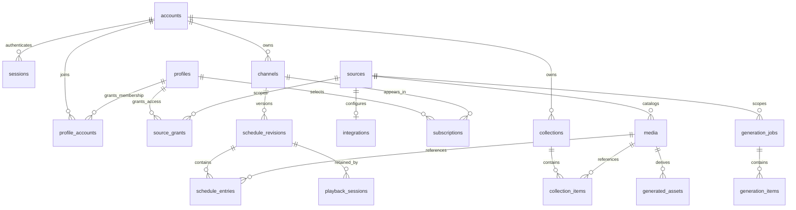

# Database and persistence reference

## Storage model

The server uses Node 24's built-in `DatabaseSync` against `mytuner.db` in `MYTUNER_DATA_DIR`. The database contains references, metadata and application state. It contains no original videos or encoded video blobs. Generated assets and caches are files outside media sources.

`src/database.ts` is the authoritative schema. There are currently **sixteen append-only migrations**, tracked by SQLite `PRAGMA user_version`. This document describes their resulting schema. SQL names use snake_case; public HTTP JSON normally converts these to camelCase.

Most entity IDs are UUID text. Authentication session identifiers are hashes, pairing identifiers are hashes, and provider IDs are source-scoped external text. Booleans are stored as integer 0/1. Time values are epoch milliseconds unless explicitly identified as a duration or relative source offset. `mtime_ms` retains the filesystem's numeric modification timestamp.

## Relationship overview

The diagram is a conceptual subset. The dictionaries below include all tables and distinguish actual foreign keys from historical references.

## Identity tables

| Table              | Columns                                                                           | Keys, relationships and behavior                                                                                                                                                           |
| ------------------ | --------------------------------------------------------------------------------- | ------------------------------------------------------------------------------------------------------------------------------------------------------------------------------------------ |
| `accounts`         | `id`, `username`, `password_hash`, `role`, `disabled`, `created_at`               | PK `id`; case-insensitive unique username; role CHECK admin/editor/viewer. Passwords are salted scrypt hashes. Disabling preserves the account and revokes sessions through service logic. |
| `sessions`         | `token_hash`, `account_id`, `expires_at`, `csrf_hash`, `kind`                     | PK `token_hash`; FK account. Stores token digest, never raw credential. Kind distinguishes bearer/browser/device; CSRF hash applies to browser sessions.                                   |
| `login_attempts`   | `key`, `failures`, `window_start`                                                 | PK `key`; shared throttle storage for login, PIN and pairing operations. Key incorporates the relevant identity/operation.                                                                 |
| `profiles`         | `id`, `name`, `kind`, `owner_account_id`, `pin_hash`                              | PK `id`; optional owner FK account; kind CHECK person/room. Person-owner requirement is enforced by API. PIN null means explicitly unprotected.                                            |
| `profile_accounts` | `profile_id`, `account_id`, `can_manage`                                          | Composite PK profile/account; FKs to both. Membership and editor management flag are separate from global role.                                                                            |
| `profile_unlocks`  | `session_hash`, `profile_id`, `expires_ms`                                        | Composite PK session/profile; FK session with cascade delete, FK profile. Unlock is local to one authentication session.                                                                   |
| `device_pairings`  | `device_hash`, `code_hash`, `device_name`, `expires_ms`, `account_id`, `consumed` | PK device hash; unique code hash; nullable approving-account FK. One-time exchange creates a viewing-only device session.                                                                  |

Owner relationships and membership rows both contribute to profile access. An account role alone does not grant every profile to non-admins. A source grant belongs to a profile, not directly to an account.

## Catalog, integration and collection tables

| Table                  | Columns                                                                                                                  | Keys, relationships and behavior                                                                                                                                                      |
| ---------------------- | ------------------------------------------------------------------------------------------------------------------------ | ------------------------------------------------------------------------------------------------------------------------------------------------------------------------------------- |
| `sources`              | `id`, `name`, `root_path`, `kind`, `recursive`, `metadata_root`, `subtitle_root`, `subtitle_config`, `subtitle_revision` | PK `id`; unique canonical root path; kind CHECK shows/movies/videos/commercials. Path/storage overlap constraints are enforced by services.                                           |
| `source_grants`        | `profile_id`, `source_id`, `subtree`                                                                                     | Composite PK profile/source/subtree; FKs profile/source. Empty subtree grants the whole root; nonempty value is a normalized relative directory.                                      |
| `media`                | `id`, `source_id`, `relative_path`, `title`, `duration_ms`, `size`, `mtime_ms`, `available`, `metadata_json`             | PK `id`; unique source/path; FK source; positive duration CHECK. Size/mtime form the current fingerprint. Missing files remain rows with `available=0`.                               |
| `integration_metadata` | `source_id`, `provider`, `external_id`, `media_id`, `metadata_json`                                                      | Composite PK source/provider/external ID; FKs source/media. Same upstream ID in different sources cannot collide. Stores matched associations, not every remote undownloaded episode. |
| `integrations`         | `id`, `source_id`, `provider`, `url`, `encrypted_key`, `mappings_json`, `last_success`                                   | PK `id`; unique source FK, so at most one saved connection per source. API key encrypted with AES-256-GCM; mappings are explicit upstream-to-server paths.                            |
| `refresh_sources`      | `source_id`, `interval_ms`, `next_run_ms`, `last_error`                                                                  | PK/FK source. Scan schedule can exist without an integration. Last error is sanitized. Removing row disables automatic refresh.                                                       |
| `refresh_attempts`     | `source_id`, `last_attempt_ms`, `last_completed_ms`, `last_success_ms`, `last_error`                                     | PK/FK source, cascade delete. Manual/periodic attempt diagnostics persist independently of refresh scheduling; sanitized error only.                                                  |
| `collections`          | `id`, `name`, `owner_account_id`                                                                                         | PK `id`; FK owner account. Saved collections are owned reference sets usable through an authorized profile.                                                                           |
| `collection_items`     | `collection_id`, `media_id`                                                                                              | Composite PK collection/media; FK collection with cascade delete, FK media. Contains no copied content.                                                                               |

`media.metadata_json` merges local metadata, imported presentation fields and technical inspection. Typical keys include `seriesId`, `seriesTitle`, `seasonNumber`, `episodeNumber`, `episodes`, `year`, `overview`, `images`, `collection`, `local`, `integrationReference`, and `technical`. These are flexible JSON rather than normalized series/season tables. Show/season/folder views are derived from authorized media. A fully undownloaded show is therefore not automatically a selectable library show.

`technical` records ffprobe duration, format and stream details. `local` preserves filename/NFO metadata even when imported fields are preferred. Imported artwork references stay server-side; public JSON replaces them with authorized proxy references.

`integrationReference` holds the active `{ provider, externalId }` association after an import. Historical `integration_metadata` rows remain; display/identity resolution uses the active reference. Older catalogs match their current imported projection before a deterministic fallback. This is catalog JSON, with no migration beyond schema 15.

## Channel and schedule tables

| Table                  | Columns                                                                                                                                  | Keys, relationships and behavior                                                                                                                                                                     |
| ---------------------- | ---------------------------------------------------------------------------------------------------------------------------------------- | ---------------------------------------------------------------------------------------------------------------------------------------------------------------------------------------------------- |
| `channels`             | `id`, `name`, `owner_account_id`, `visibility`, `archived`, `short_name`, `description`, `details_revision`                              | PK `id`; optional owner FK; visibility CHECK shared/private; private requires owner. Duplicate names are allowed because identity is ID-based. Archive is a lifecycle flag, not deletion.            |
| `channel_items`        | `channel_id`, `media_id`                                                                                                                 | Composite PK channel/media; FKs both. Tracks referenced material and supports legacy schedule authorization. It can contain historical references; current viewing checks use revision/time context. |
| `subscriptions`        | `profile_id`, `channel_id`, `position`                                                                                                   | Composite PK profile/channel; FKs both. Adds a guide choice, not an authorization override.                                                                                                          |
| `schedule_revisions`   | `id`, `channel_id`, `created_at`, `config_json`, `state_json`, `profile_id`, `author_account_id`, `effective_ms`, `boundary_state_json`  | PK `id`; FKs channel/profile/author. Nullable config supports legacy one-time schedules. Recurring config captures selectors/rules and authority context.                                            |
| `schedule_entries`     | `id`, `revision_id`, `channel_id`, `media_id`, `program_id`, `start_ms`, `end_ms`, `offset_ms`, `kind`, `source_size`, `source_mtime_ms` | PK `id`; FKs revision/channel/media. End must exceed start; offset nonnegative; kind CHECK program/commercial. Snapshots source fingerprint. Program ID groups split intervals and breaks.           |
| `active_schedules`     | `channel_id`, `revision_id`                                                                                                              | PK/FK channel; FK revision. Points to currently published revision, which can contain a preserved prefix and a future-effective edit.                                                                |
| `rotation_state`       | `channel_id`, `state_json`                                                                                                               | PK/FK channel. Current channel rotation state; revision state/checkpoints preserve version-specific continuity.                                                                                      |
| `schedule_checkpoints` | `revision_id`, `program_id`, `end_ms`, `state_json`                                                                                      | Composite PK revision/program; revision FK with cascade delete. Saves state after an entire program and related breaks for boundary-safe edits.                                                      |

`config_json` follows the programming contract: profile, groups with stable group IDs/mode/selection, optional commercial selection, rules and seed. Rotation JSON contains seeded random state, group index, ordered positions/cursors, shuffle bags, commercial counts, last play times and last commercial. Do not rewrite this JSON casually: it determines future choices and restart continuity.

Schedule entries are exact broadcast intervals, not file durations alone. For an entry, source position is `offset_ms + (broadcast_position_ms - start_ms)`. Intervals are start-inclusive/end-exclusive. A commercial inserts broadcast time while the resumed show continues from its next source offset.

## Playback and history tables

| Table               | Columns                                                                                                                               | Keys, relationships and behavior                                                                                                                                                                         |
| ------------------- | ------------------------------------------------------------------------------------------------------------------------------------- | -------------------------------------------------------------------------------------------------------------------------------------------------------------------------------------------------------- |
| `playback_sessions` | `id`, `account_id`, `profile_id`, `channel_id`, `revision_id`, `position_ms`, `anchor_ms`, `paused`, `last_seen`, `auth_session_hash` | PK `id`; FKs account/profile/channel/revision. Auth session hash binds device identity through service checks; it is not a declared FK. Position/anchor implement local playback clocks.                 |
| `playback_events`   | `id`, `session_id`, `account_id`, `channel_id`, `entry_id`, `start_ms`, `end_ms`, `created_ms`, `media_id`, `kind`, `program_id`      | PK event ID; historical IDs deliberately have no declared FKs. Captures delivery telemetry after sessions/revisions can expire. New records snapshot media/kind/program for permission-filtered history. |

A playback session is distinct from a login session. Two devices under one account must not control each other's clock. Delivered intervals use broadcast timeline milliseconds; overlapping events are unioned for duration totals, and an event ID makes a retry idempotent. Telemetry is not proof a person watched.

## Generation tables

| Table              | Columns                                                                                    | Keys, relationships and behavior                                                                                                            |
| ------------------ | ------------------------------------------------------------------------------------------ | ------------------------------------------------------------------------------------------------------------------------------------------- |
| `generation_jobs`  | `id`, `source_id`, `directory`, `recursive`, `status`, `regenerate`, `created_at`, `error` | PK `id`; source FK. Durable scoped request; source directory is relative.                                                                   |
| `generation_items` | `id`, `job_id`, `media_id`, `kind`, `status`, `error`, `waiting_reason`                    | PK `id`; FKs job/media; kind CHECK thumbnail/gif/conversion. Per-item progress and retry boundaries.                                        |
| `generated_assets` | `id`, `media_id`, `kind`, `fingerprint`, `relative_path`                                   | PK `id`; media FK; unique media/kind/fingerprint. Path is relative to generated root. Only completed atomically published output is served. |

Status transitions are implemented in `generation.ts`; they are service-enforced rather than SQL enum constraints. Queued/running work is replayed safely after restart, cancellation stops work, and retries preserve completed results.

## Indexes and constraints

Explicit indexes support channel/time lookup, revision/time lookup, program lookup, available media by source, playback events by session/time and playback sessions by authentication hash. Composite primary keys and unique constraints add their own SQLite indexes.

Foreign keys are enabled on each Store connection. Deletion does not broadly cascade: collection items, profile unlocks, schedule checkpoints and integration-run items declare cascading deletion. Services archive/revoke/collect in the required order rather than assuming every row disappears automatically.

Privacy, path containment, role checks, source fingerprint checks and revision/channel consistency need application validation. SQL constraints are necessary but are not the complete authorization model. Do not expose direct database access to clients.

## Transactions and migrations

Store enables WAL, a five-second busy timeout and foreign keys. Top-level writes use `BEGIN IMMEDIATE`; nested calls use savepoints. Transaction callbacks must be synchronous, so filesystem/network/encoding work happens outside transactions. Failed callbacks roll back their transaction/savepoint.

New schema changes append a migration and increment `user_version` only after that migration succeeds. Existing older databases receive a consistent private `VACUUM INTO` snapshot before upgrades. A future schema is rejected. Each migration commits separately. Failure rolls back that migration, while earlier successful migrations remain committed. The pre-migration snapshot is the recovery point for returning to the complete original schema. Never edit already released migrations to reinterpret old data.

The database file is restricted to mode 0600 where supported. Data remains on local app storage, not SMB/NFS. SQLite WAL support does not make multiple myTuner server owners supported.

## Backup, retention and reconciliation

Application snapshots include a consistent database, `integration.key` when present and a manifest. Original media, generated outputs and disposable caches are not included. Database-only pre-migration snapshots need the matching integration key to recover encrypted credentials. Use [operational runbooks](OPERATIONS.md), not a live `cp` of the DB file.

Maintenance expires authentication/unlock/pairing/throttle state and playback sessions idle for 24 hours. It collects superseded revisions older than seven days only if neither active nor referenced by playback. Active timeline history and delivered telemetry currently remain retained; their long-term growth/archival policy is still an acceptance item. Backups also need an operator-selected retention policy.

Restore revokes login, pairing, unlock and playback sessions and queues interrupted generation work. Source paths and generated-asset references remain logical references; restore does not recreate mounts or files. Rescan mounted sources and explicitly regenerate missing derivatives. Retention is not permission: historical queries continue to filter data using current access.

Migration 10 adds nullable `channels.short_name` (1–12 characters when supplied). Null derives a compact label from the channel name; the label is not identity and need not be unique. HTTP returns `shortName` plus nullable `shortNameOverride`. Renaming keeps a supplied override, or recomputes the derived label.

## Migration 11: lineup order and import reconciliation reports

`subscriptions.position` stores a profile's explicit guide order. Existing subscriptions migrate from name/ID order to stable numbered positions; new subscriptions append. The authorized reorder operation changes only that profile's permitted visible subscriptions and rejects stale/incomplete lists. Guide reads order by position then name/ID as a deterministic fallback. Subscription permission checks are unchanged.

`integration_runs` stores `id` (PK), `source_id` (source FK), `provider`, `completed_ms`, `scan_complete` and `summary_json`. The source/time index supports latest-report queries. A completed provider read records a report even when the accompanying scan is incomplete; provider failures do not create a success report. Refresh still guards configuration identity before publication.

`integration_run_items` stores `run_id` (FK with cascading deletion), `external_id`, nullable `previous_media_id`/`matched_media_id` and state. Its composite primary key is run/external ID. Media IDs are historical report references, not ownership or playback grants. States are new/unchanged/unmatched/reassociated/absent. Keep the latest twenty runs per source; report API details are bounded to 100 rows per page. Reports do not automatically detach metadata or delete files.

Recurring `config_json` gains optional `groups[].episodesPerTurn` (1–3). Rotation JSON gains stable `nextGroupId` and optional `remainingInTurn`; omitted turn counts preserve default-one behavior. `checkpointActions` are preview/publication commands and are stripped from persisted recurring config after execution. No source files or media blobs are added to SQLite.

## Migration 12: pending publication and encoder waiting

`schedule_revisions.boundary_state_json` stores the pre-generation rotation state at `effective_ms`, after applying one-time restart/start-at commands. `state_json` still stores the state after generated coverage. Early republish uses the boundary snapshot so it does not skip the selected first episode or replay a command after activation. Legacy null snapshots preserve the first intended pending airing before a later edit.

`generation_items.waiting_reason` is nullable transient progress. `playback-capacity` means the running item is waiting for shared encoder admission. It clears on admission, cancellation and shutdown; recovery resets interrupted running items to queued. It is not a new failure or terminal job status. Commercial retirement remains channel-local in `config_json.disabledCommercialIds`; no source media row or file is retired globally.

## Migration 13: collection recovery and explicit problem reports

`collections.deleted_ms` and `expires_ms` are nullable epoch milliseconds. Normal collection reads/pickers/edits require `deleted_ms IS NULL`. DELETE sets both dates using configured retention without deleting membership rows. Recovery checks ownership, current profile management and every current member grant, then clears both dates in one transaction; it preserves UUID/name/members, including unavailable files. An expiry index supports bounded maintenance deletion of at most 200 expired collections per pass; only collection metadata/member references cascade. Recorded expiry does not change when the default retention setting changes. Duplicate collection names are allowed.

`playback_sessions.delivery_mode` and `delivery_entry_id` record the last authorized negotiation (`direct`/`hls` and exact entry) without changing its clock, pause or revision. Reports use `unknown` when this reference does not match. They describe negotiation, not a quality/physical-output guarantee.

`problem_reports` columns: `id` UUID PK; `account_id` account FK; `request_id` UUID with unique account/request pair; `profile_id`, `channel_id`, `media_id` FKs for current-authority checks; `created_ms`; nullable `acknowledged_ms`; bounded `summary_json`. Summary contains category, browser/TV family, application build version, server preview time, authorized channel/entry reference, live/paused/behind-live state and route. It contains no media, raw errors/logs, source path, secret or PIN. Channel/entry references describe the reviewed airing; entry reference is historical JSON and does not block revision collection.

The created-time index supports age expiry. Default report retention is thirty days; maximum 1,000 rows globally; ten newly accepted reports/account/ten minutes. Admin acknowledgement changes only its timestamp; admin deletion removes only a report. Reporting accounts see only reports still permitted under current channel/profile/PIN/subscription/member grants; filtering precedes counts/paging. Administrators can inspect all reports. Five-minute preparation records are bounded in memory (five/account, 2,000 global) and intentionally disappear on restart. Durable request identity makes successful Send retries idempotent until report deletion/expiry; it is not an indefinite deduplication ledger.

`expectedRevisionId` is a preview/publication precondition, not recurring persisted configuration. Browser sends explicit UUID/null. Publish compares it to `active_schedules` inside its top-level `BEGIN IMMEDIATE` transaction before schedule/checkpoint changes; nested writes use savepoints. Omitted preconditions preserve legacy client behavior. No migration changes original media or creates source copies.

## Migration 14: independent display information

`channels.description` is non-null plain text, empty by default. `details_revision` starts at zero and supports optimistic concurrency for channel details without changing schedule revision or channel identity. `sources.metadata_root` optionally selects a canonical, protected, read-only NFO root; null uses adjacent files.

`display_metadata` has `target_key` (primary key), `source_id` (source foreign key), `revision`, `identity`, `state_json`, `local_json` and `checked_ms`. The indexed source reference scopes ownership. Target keys distinguish one show from one physical video/combined episode. Identity binds saved choices to their catalog/media identity so ambiguous replacements retain information for review without silently applying it.

`state_json` keeps independent title/description source choices and manual drafts. `local_json` retains the last successful bounded NFO snapshot, provenance/fingerprint and failed-check state. Integration candidates continue to come from imported catalog metadata; manual values remain separate from canonical show keys, episode numbers and ordering. Opening an editor reads cached values; explicit file checks and fingerprint-checked saves are separate operations. No media bytes or sidecar writes are stored or performed. See [metadata editing](METADATA_EDITING.md) for source priority, stale behavior, authority and API details.

Full application backups include this table and the added fields. A prior schema13 image cannot open schema14 data; use a compatible full pre-upgrade bundle for rollback.

## External subtitle catalog — schema 15

Migration 15 adds `sources.subtitle_root` (nullable canonical read-only path), `subtitle_config` (JSON automatic-discovery flag, relative subdirectories and depth) and `subtitle_revision` (integer compare-and-swap setting revision). Keeping the root in a separate column lets startup/restore inspect containment before opening migrated application state.

| Table             | Columns                                                      | Behavior                                                                                                                                                       |
| ----------------- | ------------------------------------------------------------ | -------------------------------------------------------------------------------------------------------------------------------------------------------------- |
| `subtitle_checks` | `media_id`, `revision`, `checked_ms`, `success_ms`, `error`  | Media PK/FK with cascade; last attempted/successful check and safe error, monotonically revised                                                                |
| `subtitle_tracks` | `id`, `media_id`, `root_kind`, `relative_path`, `state_json` | AUTOINCREMENT integer PK 1–1,000,000,000; unique media/root-kind/path; media FK with cascade; source-relative or configured-subtitle-root-relative association |

`state_json` contains origin, format/language/forced/SDH, manual flag, found/ambiguous/unsupported/missing status, subtitle size/mtime, associated video size/mtime and source-configuration signature. Stable public external track indices are 1,000,000,000 plus the row ID, distinct from embedded stream indices. Check revisions and settings/video signatures form the opaque per-video revision used for concurrent-save protection. Administrators receive relative locations; viewers never receive them. Successful checks reconcile removals; failure retains the previous association set. Configuration, associations and checks survive restart/application backup; original captions and disposable conversion cache are excluded. See [subtitle setup](SUBTITLES.md).

## Refresh attempt history — schema 16

Migration16 adds `refresh_attempts` without changing earlier migrations. It imports known prior success/error evidence from integration and schedule rows. An untouched source has no attempt row and reports `never`; absence of a periodic schedule means manual checks only. Starting a scan/metadata refresh records `last_attempt_ms` and clears completion; completion records its outcome, preserving the most recent successful check when a later check fails. A start without completion is `incomplete` (in progress or interrupted), never a healthy result.

Disabling the periodic schedule deletes only `refresh_sources`, preserving attempt diagnostics across restart. Replacing integration configuration clears the superseded attempt state; signature guards prevent old work from writing its result over the new configuration. Disconnecting an integration retains the latest diagnostic history until another source check records its outcome. Source deletion cascades diagnostics. Only the latest attempt/outcome is retained, not an unbounded event history. Backup/restore includes this table as part of SQLite. Schema16-to15 binary rollback requires restoring a compatible older backup; never decrement `user_version` manually.
