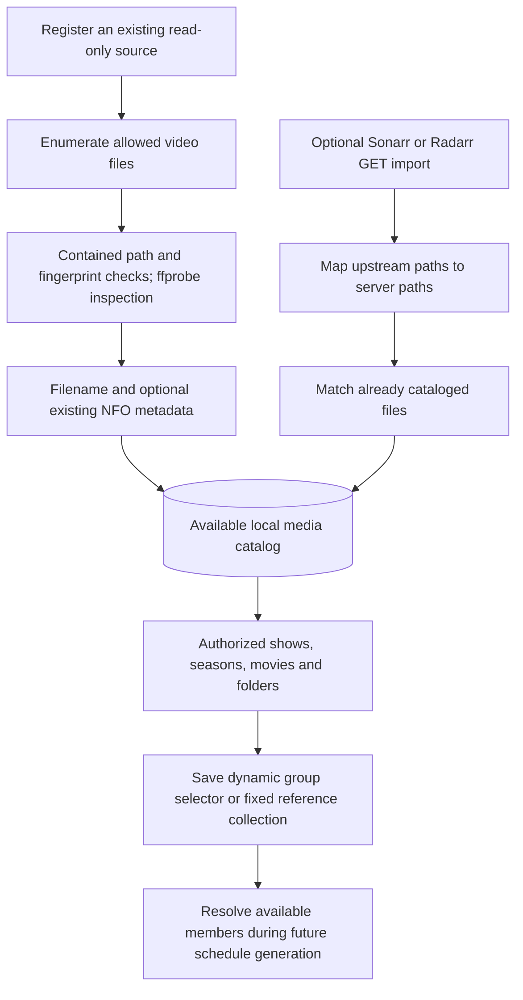

# Media discovery and library selection

## How a file becomes selectable

myTuner builds a catalog of existing files and then attaches metadata. Users choose shows, seasons, movies, folders or collections through that catalog. They do not need to locate each episode to build a channel.



The server reads originals in place. No media upload, import copy, rename, source sidecar creation or library rewrite occurs.

## Sources and directory layout

A source has a stable ID, display name, canonical directory root, recursion choice and kind: `shows`, `movies`, `videos` or `commercials`. Use independent non-overlapping roots, for example `/media/tv`, `/media/movies`, `/media/home-videos` and `/commercials`. These are examples in the server/container filesystem, not paths a TV client mounts.

Sources cannot overlap each other or application storage. Generated/cache directories cannot overlap each other. The scanner skips symlinks and validates real paths before reads. A profile can receive an entire source or only relative subtrees. All browsing and counts use those grants.

Recognized extensions currently are `.mp4`, `.mkv`, `.m4v`, `.mov`, `.avi`, `.webm`, `.ts`, `.mpeg` and `.mpg`, case-insensitively. Recognition allows inspection; it does not guarantee a particular client can decode the codecs inside the container.

A conventional layout helps filename/folder fallbacks but is not required for Sonarr/Radarr path matching:

```text
/media/tv/Example Show/Season 01/Example Show S01E01.mkv
/media/tv/Example Show/Season 01/Example Show S01E02.mkv
/media/movies/Example Movie (2024)/Example Movie (2024).mp4
/media/home-videos/Holidays/Trip 01.mp4
/commercials/Retro/Commercial 01.mp4
/commercials/Retro/Commercial 02.mp4
```

One commercial per video file gives duration, selection, repetition and delivered-exposure accounting a clear unit. Subfolders are supported through recursive sources/selections; the application does not split a long commercial reel into separate ads automatically.

## Scan algorithm and file identity

1. Enumerate directories according to the source's recursion flag, using natural numeric name ordering.
2. Ignore unsupported entries and symbolic links; resolve candidate files within the configured source.
3. Read size/mtime and existing catalog row. Identity is `(source_id, relative_path)` with a persistent media UUID.
4. Read available local metadata. Reuse prior technical inspection when an available file has the same size/mtime; otherwise run ffprobe.
5. Validate positive integer-millisecond duration, store track metadata, then recheck size/mtime to reject a file that changed during inspection.
6. Upsert the media reference. Only after a complete scan mark previously present but now absent paths unavailable.

ffprobe is limited to 30 seconds and 4 MiB of captured output per inspected file. Inspection includes container format and stream index/type/codec, language/title, dimensions/channels and default/forced flags when available.

An offline directory, unreadable subtree, failed inspection, cancellation or file changing during inspection makes the scan incomplete. Previous availability is preserved instead of marking everything missing. A later complete scan reconciles removals. Existing metadata can remain visible during an outage, while an actual delivery still fails safely if the original cannot be read.

Replacing a file at the same path preserves its media ID but changes its fingerprint. Old scheduled references and generated assets cannot silently serve the new bytes as the old content. Renaming/moving a file through another application is seen as a missing old path and newly discovered path; myTuner does not perform that move.

Size/mtime is a practical change detector, not a content hash guarantee. External tools preserving both while replacing bytes would require a stronger fingerprint strategy. Real-library replacement/rename behavior remains part of acceptance.

## Sonarr: TV discovery

A saved Sonarr integration is valid for a `shows` source. The server issues GETs against API v3:

| Endpoint                   | Used for                                                       |
| -------------------------- | -------------------------------------------------------------- |
| `series`                   | Series ID/title/overview/artwork and TVDB reference            |
| `episode?seriesId=...`     | Season/episode numbering, titles and episode-file associations |
| `episodefile?seriesId=...` | Physical file IDs and paths                                    |

Episodes are associated with files using `episodeFileId`. A physical file covering multiple episodes becomes one playable media item with its episode member list. It is not scheduled twice simply because two episode records point to it. Ordering uses the first associated numerical season/episode.

An episode without an existing matched file is not playable. The current library is not Sonarr's full wanted/upcoming calendar: shows and counts are derived from cataloged files, including retained unavailable rows. The UI must distinguish a previously cataloged unavailable item from an episode never downloaded at all.

Library browsing returns a source-scoped show key such as `series:7`, season availability counts and artwork references. A channel can select the whole show or one season. Specials (season zero) are excluded by default and must be explicitly included.

## Radarr: movies and collections

A saved Radarr integration is valid for a `movies` source. API v3 `movie` provides movie identity/title/year/overview/artwork, optional collection details and movie-file paths. A Radarr entry without an available matching catalog file cannot become playable through import. Scanned local movies remain usable even when Radarr does not manage them.

The parser tolerates supported nullable file/artwork/overview fields. If collection metadata is supplied, browse returns its source-scoped key/title/count and supports a whole-collection selector. Current code reads collection membership from the movie response; it does not make an additional collection-endpoint import or query a public movie database itself.

A Radarr collection is an integration metadata grouping. A myTuner collection is a user-owned fixed set of media references, potentially across sources. Both are selectable, but their membership update rules differ.

## Path mapping: the common integration issue

Sonarr, Radarr and myTuner may mount the same host share under different paths. Match the path seen by the upstream application to the path visible inside myTuner:

| Host file                                               | Sonarr path                              | myTuner path                                   |
| ------------------------------------------------------- | ---------------------------------------- | ---------------------------------------------- |
| `/mnt/user/media/tv/Example Show/Season 01/Episode.mkv` | `/tv/Example Show/Season 01/Episode.mkv` | `/media/tv/Example Show/Season 01/Episode.mkv` |

Example connection payload:

```json
{
  "provider": "sonarr",
  "url": "http://sonarr:8989",
  "apiKey": "<supply privately>",
  "mappings": [{ "from": "/tv", "to": "/media/tv" }]
}
```

The target must remain within the source root. Mapping uses the longest matching directory-boundary prefix; `/tv` must not match `/tv-old`. Backslashes are normalized for upstream Windows paths, drive-letter mappings compare without case, and traversal components are rejected. Relative media paths stored in the database use forward slashes.

`matched` means an upstream item mapped to an available catalog file; `unmatched` can mean a wrong mount mapping, out-of-source path, absent file or unscanned directory. Fix visibility/mapping before assuming metadata is missing.

## Custom directories and existing NFO files

Custom media needs no Sonarr, Radarr, Plex or external matching service. A filename supplies a readable title. Recognized `S01E02`-style patterns supply series title, season and episode; a range can record a final episode number. Other filenames may supply a year.

Existing adjacent metadata can enrich the file. The parser tries a matching `.nfo`, then directory-level `movie.nfo` for movie sources or `episode.nfo` otherwise. It reads supported `movie` or `episodedetails` XML fields: title, plot, showtitle, season, episode, year and collection set. Files over 256 KiB, invalid XML and DOCTYPE/entity declarations are ignored. Optional metadata failure does not block cataloging an otherwise valid video.

For example, these existing basename-matched files use the currently supported fields. They illustrate readable inputs, not instructions to create or repair files in a read-only library.

`Orbit S02E03.mkv` with an existing `Orbit S02E03.nfo`:

```xml
<episodedetails>
  <title>A Signal Returns</title>
  <showtitle>Orbit</showtitle>
  <season>2</season>
  <episode>3</episode>
  <plot>The crew traces a familiar signal.</plot>
</episodedetails>
```

`Night Crossing.mkv` with an existing `Night Crossing.nfo`:

```xml
<movie>
  <title>Night Crossing</title>
  <year>2024</year>
  <plot>A journey continues after sunset.</plot>
  <set>Crossing Stories</set>
</movie>
```

`plot` supplies the description. Missing numeric tags retain filename-derived numbering. Corrected [R9-01](IMPLEMENTATION_REVIEW.md#selected-ninth-round-correction-disposition): empty/whitespace/malformed numeric tags now retain filename-derived numbering. Only valid nonempty decimal safe integers replace it. Run a normal source rescan to refresh catalog rows imported before this fix; original files remain unchanged. Explicit `<season>0</season>` is a legitimate special. These examples do not imply arbitrary NFO dialect support.

Automatic source scans do not use `tvshow.nfo` for catalog grouping. Administrators can check it for show display title/description through **Library → Open details → Edit information → Check metadata files**, then select **Local metadata** and **Save information**. See [metadata editing](METADATA_EDITING.md). Arbitrary artwork/chapter sidecars and every NFO dialect remain unsupported. Thumbnail/GIF generation is a separate explicit action. Nothing writes or repairs metadata beside an original.

A custom episode with an absent or null season number is displayed, selected and scheduled as Season 1. Browsing counts, season selectors, schedule clips and retained show cursors use the same fallback, so mixed explicit/fallback episodes continue in numerical episode order. Unavailable files stay excluded from playable selection. An explicit season zero remains a special and requires opt-in. Other source kinds retain their existing ordering. This fallback does not rewrite source files or stored metadata.

Show grouping prefers imported series ID, then a normalized local series-title key, then a folder fallback with a conventional season directory removed. This keeps different locally named shows separate even when their episodes share one directory. Identically named local shows in the same source may need clearer metadata/folders; there is no full external identity resolver.

## Library search

`GET /api/profiles/:profileId/library?search=...` accepts a trimmed query of up to 200 characters. Matching is case-insensitive across item titles, relative file paths, series titles, collection titles and source names. Profile/source authorization is applied before matching. A filename match returns its containing show, folder or collection with the full authorized counts and membership; selecting that parent still selects the whole group. Movies return as individual matches. A query with no matches returns empty groups.

The browser sends this query after a 200 ms debounce. Saved myTuner collections are filtered by collection name separately; filename matching applies to the catalog groups above. Files and metadata are read from the local catalog, without an upstream search or a filesystem walk per keystroke.

## Selection semantics

| Selector                      | Stored reference                                 | Future membership                                                      |
| ----------------------------- | ------------------------------------------------ | ---------------------------------------------------------------------- |
| Whole show                    | Source ID plus returned show key                 | Available matching episodes, excluding specials unless enabled         |
| Season                        | Show selector plus season number                 | Available matching episodes in that season                             |
| Folder                        | Source ID, relative directory and recursion flag | Available matching files under that scope                              |
| Radarr/local movie collection | Source ID plus returned collection key           | Available files currently carrying that collection metadata            |
| myTuner collection            | Collection ID                                    | Saved reference set; adding a file to a directory does not add it here |
| Individual files              | Media UUID list                                  | Fixed IDs; unavailable/unauthorized members cannot become playable     |

Always use keys returned by library browsing. Selection previews resolve membership but do not publish schedules. The ordered schedule uses numerical season/episode, then natural title and UUID tie-breakers; folder selection alone does not imply path traversal order is the final broadcast order.

After a complete refresh, a dynamic selection sees additions when future schedule batches resolve its members. It does not insert a new episode into an already materialized airing or rewind every show's cursor. Publish/review updated programming when immediate future-guide changes are desired. A fixed collection requires an explicit membership edit.

## Refresh, outages and removal policy

Registering a source does not enable an automatic filesystem watcher or generation job. Trigger a scan, optionally save a connection, then set a refresh interval from one minute to seven days. Null disables it. The server checks due sources every 30 seconds, deduplicates concurrent requests for the same source and configuration, and caps running refresh jobs at two. If a connection changes during a refresh, superseded results cannot import metadata or update success/error status for the new settings. A scan requested with the new settings waits for old work to settle and then scans again using the current connection.

Saved refresh scans first, then imports metadata if configured. A failed upstream request retains prior imports and retries after at most five minutes or the shorter configured interval. The filesystem remains authoritative for file availability. Removing a saved connection stops future upstream reads but does not erase existing imported metadata.

Successful imports currently upsert matches; they do not sweep every historical association absent from a later upstream response. Successful-removal/reassociation policy and installed-version compatibility remain tracked acceptance work. Do not describe upstream disappearance as automatic deletion of a video, show or previous metadata.

Artwork is proxied only from permitted MediaCover paths on the saved configured integration host. Remote image references are not a promise of arbitrary internet artwork retrieval. MIME/size/time bounds, credential isolation and source permissions apply; missing artwork needs a client placeholder.

For requests and route details see [BACKEND.md](BACKEND.md). For server, upstream and client responsibilities see [APPLICATIONS.md](APPLICATIONS.md).

## Local metadata removal and selected discovery improvements

A successfully parsed, supported replacement local NFO replaces locally owned descriptive/grouping fields when no integration owns the item. Removing a collection from a valid NFO therefore removes stale movie-collection membership even if video size/mtime is unchanged. Technical inspection data and active integration ownership remain intact. Missing/malformed/oversized optional sidecars keep the prior outage/fallback semantics; a partial read is not treated as an intentional metadata removal. Source media/sidecars are read only.

Selected improvements add admin import-run reconciliation reports, read-only mapping preflight and a bounded authorized programming-options API. Reports record absent/reassociated matches without automatically detaching metadata. Failed provider reads preserve prior associations. Complete installed-provider removal acceptance remains outstanding. Picker search includes actual filenames, groups by source/type and permits show/season drill-down; its response is bounded while aggregation still scans authorized entries. See [the selected implementation plan](SELECTED_IMPROVEMENTS.md) for benchmark evidence and remaining UI work.

## Selected I47 local-file metadata extension

Local metadata files are implemented as the third editable-information source alongside Sonarr/Radarr and manual SQLite values. [METADATA_EDITING.md](METADATA_EDITING.md) records per-field source selection, show-level `tvshow.nfo`, adjacent or separately configured read-only metadata roots using matched relative paths, cached provenance and explicit file rechecks. Schema 14, the metadata Edit modal and source mapping have local regression evidence. No web lookup, URL parsing or sidecar creation is included.

## Subtitle discovery

Source scans now discover external `.srt`, `.vtt`, `.ass` and `.ssa` alongside embedded audio/subtitle inspection. Deterministic video-basename matches work beside the video, in conventional/configured relative subdirectories and in a separately configured mirrored read-only root. Generic filenames remain ambiguous. Settings and admin preview/association, check history/provenance and missing/unsupported states are persisted in schema 15. Source and subtitle originals remain unchanged. See [subtitle setup](SUBTITLES.md) for naming examples, limits, management instructions, retry semantics and supported-format boundaries; NFO descriptive metadata configuration remains independent.

## R10 catalog corrections and rescan guidance

Generic movie.nfo or episode.nfo is used automatically only in a directory with exactly one supported regular video. Per-video basename NFO takes precedence; multiple videos require unambiguous per-video metadata or manual display choices. An empty/whitespace title preserves the filename title. Existing folder-identified shows support the same manual/local/integration display resolver while keeping their original selection key.

After updating from the earlier POC, run Scan & refresh metadata on affected sources to rebuild stale locally sourced titles/descriptions/order from the current read-only inputs. No sidecar edits or source moves are required. Integration imports retain prior association rows but record the current provider/external-ID reference in media metadata JSON; display resolution uses that reference. A normal same-identity refresh keeps custom choices, while replacement identities retain the existing review requirement. The schema version remains 15.
